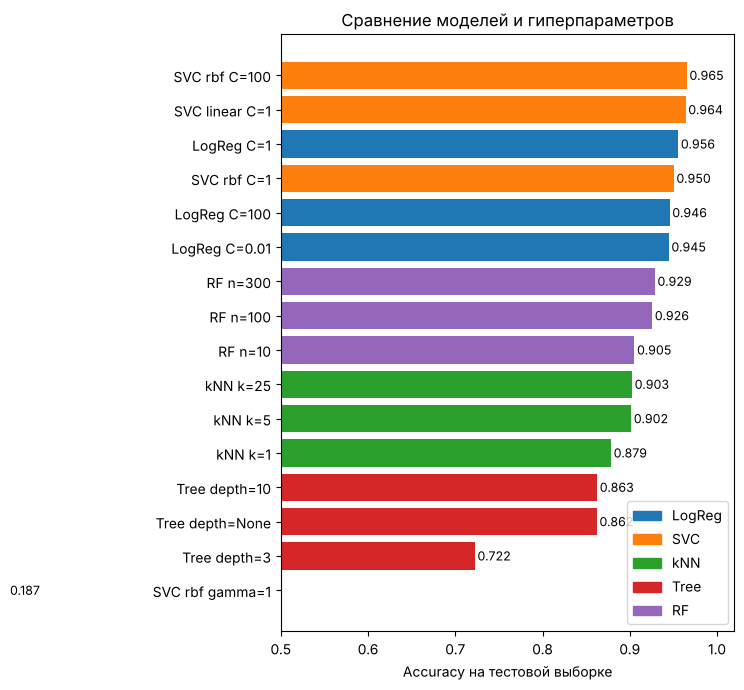
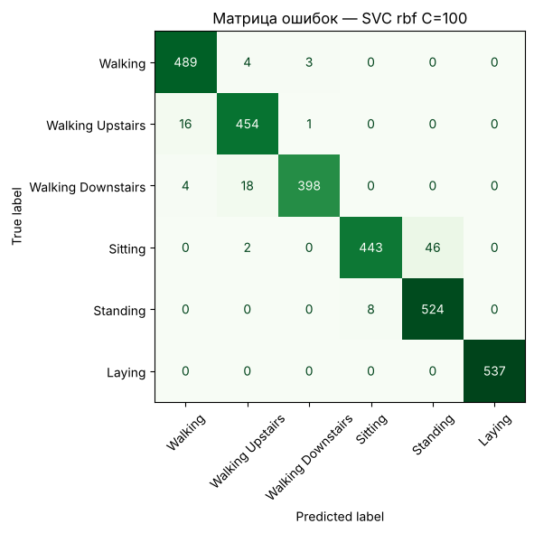
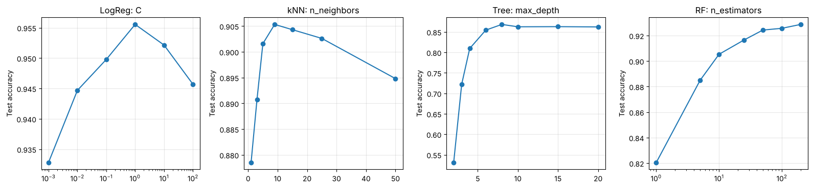

# Lab 1: Classification
# Лабораторная работа №1: Классификация

**EN:** Human activity recognition from smartphone sensor data (accelerometer and gyroscope). Six classes: walking, walking upstairs, walking downstairs, sitting, standing, laying. Logistic regression as the main model, compared with SVM, kNN, a decision tree and a random forest with different hyperparameters. Classification report (precision, recall, F1), confusion matrix, effect of hyperparameters, underfitting and overfitting.

**RU:** Распознавание активности человека по данным датчиков смартфона (акселерометр и гироскоп). Шесть классов: ходьба, подъём и спуск по лестнице, сидит, стоит, лежит. Основная модель — логистическая регрессия; сравнение с SVM, kNN, деревом решений и случайным лесом при разных гиперпараметрах. Отчёт о классификации (precision, recall, F1), матрица ошибок, влияние гиперпараметров, недообучение и переобучение.

## 📊 Data
[Human Activity Recognition Using Smartphones](https://www.kaggle.com/datasets/uciml/human-activity-recognition-with-smartphones): 30 participants, 561 features per window, 7352 training and 2947 test samples. No missing values, classes roughly balanced.

## ⚙️ Approach
1. Split the data into features `X` (561) and labels `y` (6 classes). `Activity` (the target) and `subject` (participant id) are excluded from the features.
2. Main model: `StandardScaler` + `LogisticRegression(C=1)`.
3. 16 experiments: logistic regression (`C`), SVM (`kernel`, `C`, `gamma`), kNN (`n_neighbors`), decision tree (`max_depth`), random forest (`n_estimators`).
4. Train vs test accuracy to detect overfitting; validation curves for each hyperparameter.

## ✅ Results

| Model | Hyperparameters | Test accuracy |
|-------|-----------------|---------------|
| **SVM** | RBF kernel, C = 100 | **0.965** |
| SVM | linear kernel | 0.964 |
| Logistic regression | C = 1 | 0.956 |
| Random forest | 300 trees | 0.929 |
| kNN | k = 25 | 0.903 |
| Decision tree | max_depth = 10 | 0.863 |
| SVM | RBF, gamma = 1 (overfitting example) | 0.187 |

The most frequent error is **Sitting ↔ Standing**: both postures are static, so the sensor signals are very similar.

  
  

  

## 📁 Files
- [`lab1_classification.ipynb`](lab1_classification.ipynb) — notebook with code and outputs
- [`lab1_report.pdf`](lab1_report.pdf) — report
- [`images/`](images/) — charts

To run the notebook, put `train.csv` and `test.csv` from the dataset into `/data/notebook_files/` or next to the notebook.
